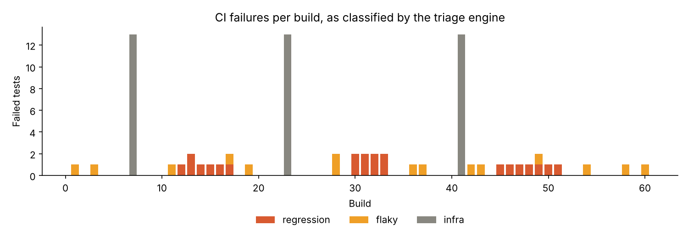

# CI Failure Triage: rules first, AI where it helps

In a large CI pipeline, most red tests are not new bugs. Lab outages and flaky
tests bury the real regressions, and engineers lose hours finding out which is which.

This prototype takes a CI history and, for every failed test, decides whether it is a
**real regression**, a **flaky test** or an **infrastructure problem**. It groups the
failures into incidents, points to the suspect commit, and reports quality KPIs.
An AI layer writes a short triage note per incident and ranks suspect commits.

## How it works

```
CI history (builds, commits, test results, reruns)
        │
        ▼
1. Signature        normalise logs (mask numbers, node names, ids)
2. Infrastructure   same signature in 3+ components in one build  → lab problem
3. Flaky            passes on rerun, or matches a flaky signature seen earlier
4. Regression       persists on rerun → group consecutive failures into an incident
                    → suspect commits = changes to that component in the first red build
5. AI triage note   summary, likely cause, ranked suspects, confidence, action, owner
        │
        ▼
incidents + accuracy vs. ground truth + quality KPIs + timeline chart
```

The deterministic rules do the classification. The AI is used for what rules cannot do
well: reading failure and commit messages to rank suspects, and writing a note an
engineer can act on in under a minute, including a confidence level.

## Run it

```bash
pip install matplotlib
python simulate.py    # creates data/ci_history.json (seeded, reproducible)
python evaluate.py    # writes results/report.md and results/timeline.png
```

## Results

Synthetic history: 60 builds, 30 tests in 5 radio-unit-style components, 76 failed test
runs. Ground truth: 3 regressions, 3 flaky tests, 3 lab outages.

| | Baseline: "passes on rerun = flaky, else bug" | Triage engine |
|---|---|---|
| Accuracy over all 76 failures | 43% | **99%** |
| Lab-outage failures treated as code bugs | 39 | 0 |
| Real regressions found | 3 of 3 (buried among 64 "bugs") | 3 of 3 |
| False regression alarms | – | 1 (flagged low confidence) |

- **76 raw failures became 10 incidents** (87% fewer items to look at). Estimated triage
  effort drops from about 12.7 h to 2.5 h, under stated assumptions of 10 min per raw failure
  and 15 min per incident.
- The rules narrowed each regression to 1–2 candidate commits. The AI note ranked the
  introducing commit first in all 3 real regressions.
- KPIs in the report: time to fix per regression (48–84 h), flaky rate per test (up to 12% of
  builds), builds lost to lab outages, regression failures per component.



## What I learned from building it

- **The common rerun rule is not enough.** It catches most flaky tests, but every lab outage
  looks like a bug, and two-thirds of the "bugs" it reports are not in the code.
- **History matters.** A test that fails twice in a row can still be flaky. Remembering flaky
  signatures from earlier builds fixed most of those cases, using only past data, as a live
  pipeline would.
- **Some cases stay ambiguous.** A one-off failure in a retry-based test looked like a regression.
  Showing the confidence level is more honest than forcing a label.

## Limitations

- **Synthetic data.** The history is generated, with component names inspired by typical radio
  unit software areas. Real pipelines have messier logs, more causes (environment, test-order
  dependencies) and much larger volumes.
- **Cached AI output.** The triage notes in `llm_outputs/` were written by Claude using the prompt
  in `prompts/triage_note.md`, and cached so runs are reproducible. Judging the AI ranking against
  ground truth in a real study needs many incidents and repeated runs.
- **Simple rules.** Thresholds (3 components for infra) are fixed by hand; in practice they would
  be tuned on historical data.
