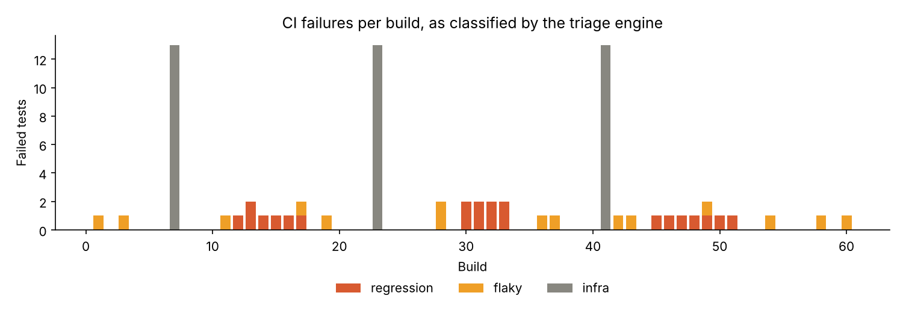

# Evaluation results

Synthetic CI history: 60 builds, 30 tests, **76 failed test runs**. Ground truth: 3 regressions, 3 flaky tests, 3 lab outages.

## 1. Classification of every failure

| | Baseline: "passes on rerun = flaky, else bug" | Triage engine |
|---|---|---|
| Accuracy | 43% | **99%** |
| Regression: precision / recall | 33% / 100% | 95% / 100% |
| Flaky: precision / recall | 100% / 75% | 100% / 94% |
| Infra: precision / recall | 0% / 0% | 100% / 100% |

Confusion matrix of the triage engine (rows = truth, columns = predicted):

| truth \ predicted | regression | flaky | infra |
|---|---|---|---|
| regression | 21 | 0 | 0 |
| flaky | 1 | 15 | 0 |
| infra | 0 | 0 | 39 |

The baseline labels all 39 lab-outage failures as code bugs, so engineers would chase problems that are not in the code.

## 2. Regressions and suspect commits

| Incident | Real regression | Builds | Candidate commits (rules) | Introducing commit | AI top suspect |
|---|---|---|---|---|---|
| R-01 | R1 | 6 | c0024, c0026 | c0026 | c0026 ✔ |
| R-02 | **false alarm (flaky)** | 1 | c0027 | – | c0027 |
| R-03 | R2 | 4 | c0062, c0061 | c0061 | c0061 ✔ |
| R-04 | R3 | 7 | c0091 | c0091 | c0091 ✔ |

All 3 of 3 real regressions were found. The rules narrow each one to 1–2 candidate commits; the AI note picked the introducing commit first in every real regression. One one-off flaky failure became a false alarm, and its note flagged it as low confidence.

## 3. Noise reduction and engineer time

- 76 raw failures → **10 incidents** (87% fewer items to look at).
- Builds with at least one red test: 32 of 60. Builds with a real code regression: 17.
- Estimated triage time: 12.7 h one failure at a time vs. 2.5 h per incident (assumes 10 min per raw failure and 15 min per incident).

## 4. Quality KPIs

| KPI | Value |
|---|---|
| Time to fix R-01 (power_control) | 72 h |
| Time to fix R-03 (fronthaul) | 48 h |
| Time to fix R-04 (carrier_config) | 84 h |
| Flaky rate alarm_handling::test_alarm_clear_timing | 12% of builds |
| Flaky rate fronthaul::test_link_recovery | 2% of builds |
| Flaky rate sw_upgrade::test_rollback_timeout | 12% of builds |
| Builds lost to lab outages | 3 |
| Regression failures by component | power_control: 6, fronthaul: 9, carrier_config: 7 |

## 5. Triage notes (AI layer)

**R-01** (regression): test_tx_power_limit fails in 6 builds: transmitted power is just above the 46.0 dBm limit. *Action:* Revert or correct c0026 'Tune PA output calibration table'. *Owner:* Commit author (elin). *Confidence:* high: consistent failure since one build, and a calibration commit in that build.

**R-02** (regression): test_link_recovery failed once: the eCPRI link did not recover within the retry limit. *Action:* Rerun and watch the next builds before reverting; check if the test is timing-sensitive. *Owner:* Test owner for fronthaul. *Confidence:* low: single failure in a retry-based test; the config-parsing commit is a weak match.

**R-03** (regression): Two fronthaul timing tests fail together in 4 builds: measured delay and frame timing are out of range. *Action:* Fix or revert c0061 'Change delay compensation to use new timestamp source'. *Owner:* Commit author (jonas). *Confidence:* high: both failures are timing-related and c0061 changes delay compensation; c0062 only edits a README.

**R-04** (regression): test_bandwidth_change fails in 7 builds with a missing 'bw_100mhz' key in the carrier profile. *Action:* Add the missing key to the schema migration in c0091. *Owner:* Commit author (sara). *Confidence:* high: KeyError matches a schema migration commit in the first failing build.

**F-test_alarm_clear_timing** (flaky): test_alarm_clear_timing fails at random (7 times) with alarm-clear timeouts. *Action:* Quarantine and rewrite the test to wait for the event instead of a fixed timeout. *Owner:* Test owner for alarm_handling. *Confidence:* high: failures pass on rerun and appear without related code changes.

**F-test_link_recovery** (flaky): test_link_recovery failed once and passed on rerun. *Action:* Track; quarantine if it repeats. *Owner:* Test owner for fronthaul. *Confidence:* medium: only one confirmed flaky run so far.

**F-test_rollback_timeout** (flaky): test_rollback_timeout fails at random (7 times) while the package is still activating. *Action:* Quarantine; make the timeout depend on the activation state. *Owner:* Test owner for sw_upgrade. *Confidence:* high: failures pass on rerun and have no related code changes.

**I-b007** (infra): 13 tests in 5 components fail in one build because a lab node is unreachable. *Action:* Do not investigate the code; rerun the build after the lab team restores the node. *Owner:* Lab team. *Confidence:* high: same connection error across unrelated components.

**I-b023** (infra): 13 tests in 5 components fail in one build because a lab node is unreachable. *Action:* Rerun after the lab team restores the node. *Owner:* Lab team. *Confidence:* high: same connection error across unrelated components.

**I-b041** (infra): 13 tests in 5 components fail in one build; rulab-03 is unreachable again. *Action:* Rerun, and raise the repeated rulab-03 outage with the lab team. *Owner:* Lab team. *Confidence:* high: same connection error across unrelated components.

